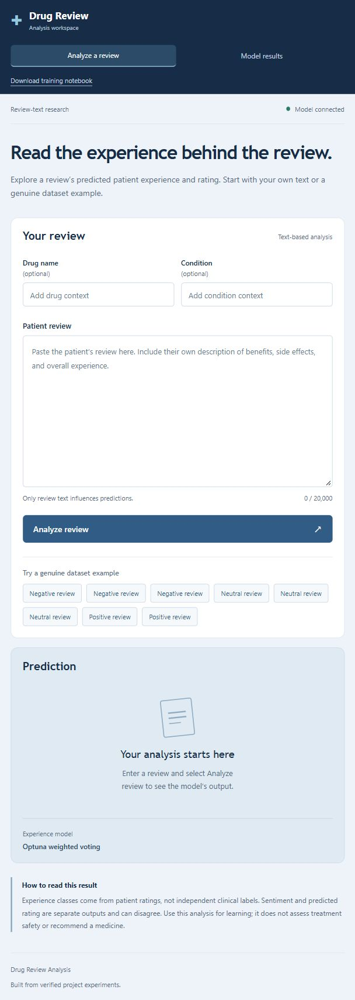
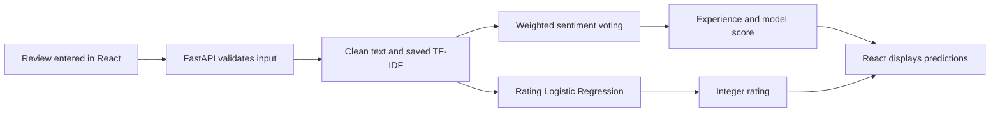

# ReviewRx

### Drug Review Sentiment & Rating Prediction

ReviewRx analyzes a written patient review and predicts **Negative / Neutral / Positive experience**, an estimated **rating from 1 to 10**, and a model score. This college ML/NLP project includes an educational Colab notebook, saved scikit-learn pipelines, a React interface and a FastAPI backend.

**Recorded sentiment validation accuracy: 76.56% · Macro-F1: 0.6510.** The separate rating model has **1.5269 validation MAE**. These are measured results, not a promise for every new review.



[Notebook](Improved_ML_Training.ipynb) · [Analysis](MODEL_ANALYSIS.md) · [Detailed comparisons](MODEL_COMPARISON.md) · [Dataset terms](DATASET.md)

## Why we built it

Patient reviews can express benefits, side effects, disappointment and mixed experiences in the same paragraph. ReviewRx demonstrates how NLP can learn from historical reviews and summarize the experience expressed in new text. It also shows why data leakage, class imbalance and evaluation choices matter more than chasing a high accuracy number.

After setup you can:

- Paste an English-language review and get predictions without retraining.
- Compare experience, estimated rating and confidence together.
- Try eight genuine dataset examples after obtaining the dataset locally.
- Explore the **Model results** dashboard and understand the measured comparisons.
- Download/rerun the notebook or integrate the prediction API into another application.

Drug name and condition are optional **display context**. Only review text influences predictions. The app does not recommend a drug, diagnose a condition, calculate doses or determine clinical safety. Submitted reviews are not persisted.

## Objectives

1. Reproduce the original model and inspect the supplied notebook, execution PDF and actual CSVs.
2. Diagnose missing values, repeated reviews, label distribution and train/test text overlap.
3. Keep identical cleaned reviews together during splitting and cross-validation.
4. Compare suitable sparse-text models on consistent validation data.
5. Tune with RandomizedSearchCV and Optuna without test-data tuning.
6. Test bagging, boosting and voting, selecting by validation macro-F1.
7. Save complete preprocessing/model pipelines and connect them to React + FastAPI.
8. Explain real improvements and remaining limitations for a college presentation.

## Dataset and source

The experiments used the supplied `drugsComTrain_raw.csv` and `drugsComTest_raw.csv`. Their filenames, schema and sizes match the commonly distributed **Drug Review Dataset (Drugs.com)** / **UCI ML Drug Review dataset**. The exact original download location of the supplied copies was not recorded; this project did not scrape Drugs.com itself.

The [Kaggle source/mirror](https://www.kaggle.com/datasets/jessicali9530/kuc-hackathon-winter-2018) credits Gräßer, Kallumadi, Malberg and Zaunseder, *Aspect-Based Sentiment Analysis of Drug Reviews Applying Cross-Domain and Cross-Data Learning* (2018), and the original UCI publication. The [historical UCI entry](https://archive.ics.uci.edu/dataset/462/drug+review+dataset+drugs+com) was unavailable during the 9 October 2026 publication check.

| File | Rows | Columns |
|---|---:|---:|
| Training CSV | 161,297 | 7 |
| Provided test CSV | 53,766 | 7 |
| Total | 215,063 | 7 |

| Column | Role in this project |
|---|---|
| `uniqueID` | Review identifier; excluded from predictive features |
| `drugName` | Display context |
| `condition` | Display context and EDA |
| `review` | **Model input** |
| `rating` | **Training target**, excluded from predictive features |
| `date` | Audit/EDA only |
| `usefulCount` | Audit/EDA only |

Experience classes come from recorded ratings: **1–3 Negative**, **4–6 Neutral**, **7–10 Positive**. They are proxy labels, not independent clinical sentiment annotations. Raw training counts are 35,063 Negative, 19,368 Neutral and 106,866 Positive.

**CSV files and copied patient reviews are excluded from Git.** The source description restricts redistribution and commercial use. Each reader must obtain the files directly and follow its terms; see [DATASET.md](DATASET.md). Saved pipelines are included, so ordinary app predictions do not require CSVs.

## How it works



Cleaning decodes HTML entities, removes wrapping quotes and normalizes whitespace while retaining negation and numbers. TF-IDF converts words and word pairs into sparse numerical features. Vocabulary/IDF and feature selection are learned only from training data or the appropriate training fold.

FastAPI loads trusted model files once at startup. Prediction requests run inference only; they do not train models or run Optuna. Cleaning is consistent across the notebook, Python helper and backend.

## Current algorithms

### Experience: Optuna-weighted soft voting

| Component | Selected settings | Weight |
|---|---|---:|
| Logistic Regression | `C=0.580958`, balanced class weights | 1.00 |
| Complement Naive Bayes | `alpha=0.102535` | 0.50 |
| Bagged Complement NB | 3 bootstrap estimators, `max_samples=0.5`, `alpha=0.175060` | 0.01 |
| AdaBoost | 40 depth-2 trees, learning rate 1.395561 | 0.50 |

Shared TF-IDF: up to 80,000 terms, word unigrams/bigrams, `min_df=2`, sublinear term frequency. AdaBoost additionally selects 8,000 terms with chi-square selection inside training folds; trees consider 10% of selected terms at a split.

Bagging averages models trained on bootstrap samples. Boosting sequentially reweights observations. Soft voting combines component probabilities. The small bagging weight is a reminder that adding an algorithm does not automatically help; we have no controlled ablation proving that every component contributes a gain.

### Rating: separate Logistic Regression

The rating pipeline predicts one of ten integer ratings with richer TF-IDF, `C=4.0` and no balanced class weights. It was selected using **MAE**, because a one-point rating error is different from a nine-point error. Optuna-tuned rating Naive Bayes had worse validation MAE, so the existing rating winner remained.

## Real model comparison

All rows below use the same cleaned development split and grouped folds. Precision/recall/F1 are macro-averaged. ROC-AUC is macro one-vs-rest. CV is a model-selection estimate, not nested cross-validation.

| Model | CV F1 | Val. accuracy | Precision | Recall | Val. F1 | ROC-AUC |
|---|---:|---:|---:|---:|---:|---:|
| Original settings (fair split) | 0.6372 | 74.37% | 0.6298 | 0.6655 | 0.6396 | 0.8697 |
| Richer logistic | 0.6336 | 75.93% | 0.6296 | 0.6527 | 0.6387 | 0.8647 |
| Linear SVM | 0.6194 | 77.45% | 0.6281 | 0.6273 | 0.6272 | 0.8512 |
| Complement NB | 0.5724 | 75.65% | 0.5997 | 0.5964 | 0.5739 | 0.8534 |
| Tuned logistic | 0.6399 | 75.32% | 0.6369 | 0.6718 | 0.6478 | 0.8710 |
| Word + character logistic | 0.6352 | 75.25% | 0.6343 | 0.6674 | 0.6448 | 0.8705 |
| Optuna Logistic Regression | 0.6399 | 74.68% | 0.6353 | 0.6727 | 0.6456 | 0.8713 |
| Optuna Complement NB | 0.5779 | 75.60% | 0.5990 | 0.5996 | 0.5784 | 0.8530 |
| Optuna Bagging NB | 0.5706 | 75.79% | 0.5939 | 0.5899 | 0.5696 | 0.8493 |
| Optuna AdaBoost | 0.4094 | 69.47% | 0.5459 | 0.4104 | 0.3966 | 0.7017 |
| Bagging + boosting voting | 0.5666 | 76.28% | 0.6010 | 0.5852 | 0.5628 | 0.8512 |
| Optuna weighted voting | 0.6453 | 76.56% | 0.6393 | 0.6687 | 0.6510 | 0.8775 |

### Why the current model won

**Weighted voting had the highest common-validation macro-F1 (0.6510)** and the strongest recorded CV macro-F1 (0.6453). Against the previous tuned-logistic winner, validation accuracy increased from **75.32% to 76.56%** (+1.24 percentage points), and macro-F1 increased from **0.6478 to 0.6510**. This is a modest measured gain.

It was selected for macro-F1, not the highest accuracy. Positive reviews dominate the dataset, so accuracy alone can hide poorer treatment of smaller classes.

### What happened with the other models?

- **Linear SVM:** higher accuracy (77.45%), but lower macro-F1 (0.6272). Training F1 0.9668 versus validation 0.6272 showed a large generalization gap.
- **Richer Logistic Regression:** training F1 0.9203 versus validation 0.6387; a bigger representation alone did not improve the selection metric.
- **Word + character features:** F1 0.6448 was below tuned logistic, and the recorded fit took about 357 seconds.
- **Naive Bayes and bagging NB:** lower validation macro-F1; bootstrapping NB did not outperform the tuned linear model on the chosen metric.
- **AdaBoost:** training F1 0.3940 and validation F1 0.3966 indicate underfitting in this bounded text configuration. An earlier all-feature boosting search was expensive and also performed poorly.
- **Bagging + boosting alone:** accuracy 76.28% hid macro-F1 of just 0.5628. Combining two methods was insufficient; the broader ensemble performed better.
- **Optuna:** systematically explored settings but did not make every model beat the earlier winner. Small trial budgets do not guarantee global optimum.

### Rating results

| Metric | Validation | Previously evaluated test: repeat assessment |
|---|---:|---:|
| MAE, lower is better | 1.5269 | 1.4827 |
| RMSE | 2.6272 | 2.5751 |
| Exact accuracy | 41.98% | 43.14% |
| Within one rating point | 67.95% | 68.74% |

### Evaluation protocol and limits

After deduplicating text/rating pairs, development has 112,381 records: **95,528 training** and **16,853 validation**. Identical normalized texts stay in the same group. CV uses three StratifiedGroupKFold folds. The provided test contains 32,228 normalized-text rows overlapping original training, so only **16,141 non-overlapping examples** are reserved.

The current sentiment ensemble scored **76.70% accuracy**, **0.6477 macro-F1** and **0.8767 ROC-AUC** on that subset. It had already been evaluated before the ensemble extension: these are **repeated test results**, not new independent confirmation.

Remaining limitations include subjective/conflicting ratings, difficult Neutral reviews, historical data, undetected paraphrases and repeated validation selection. Ensemble training F1 is **0.7976** versus **0.6510** validation: overfitting remains. Voting weights use the same training folds as component tuning, so selection optimism is possible. Confidence is the maximum class probability, not an independently calibrated chance of correctness. A fresh external dataset is the next useful check.

## Setup: run the trained application

The saved models and built React frontend are included. **No notebook training or CSV download is needed for manually entered reviews.**

Use a recent Python compatible with the pinned dependencies (Python 3.14.2 was used locally; this package set requires Python 3.11+).

```powershell
git clone https://github.com/FutureAlok1445/ReviewRx-Drug-Review-Sentiment-Rating-Prediction.git
cd ReviewRx-Drug-Review-Sentiment-Rating-Prediction
python -m venv .venv
.\.venv\Scripts\python.exe -m pip install -r webapp/backend/requirements.txt
.\.venv\Scripts\python.exe -m uvicorn webapp.backend.main:app --host 127.0.0.1 --port 8000
```

On macOS/Linux use `.venv/bin/python` instead of `.\.venv\Scripts\python.exe`.

Open **http://127.0.0.1:8000**. Interactive API documentation: **http://127.0.0.1:8000/docs**. Keep the terminal running; stop with `Ctrl+C`.

### How to use it after setup

1. Open **Analyze a review**.
2. Paste an English review into **Patient review**. Drug and condition are optional.
3. Click **Analyze review**.
4. Read experience, predicted rating and model score together.
5. Open **Model results** to inspect the measured comparisons and test-status note.
6. Try mixed/critical reviews too. An incorrect prediction is useful for understanding limitations.

Experience and rating use separate models and can disagree. A Neutral experience with predicted rating 7 is possible; the application does not force the outputs to agree.

### Eight genuine examples you can test

Obtain the CSVs directly from the [dataset source](https://www.kaggle.com/datasets/jessicali9530/kuc-hackathon-winter-2018), follow its terms, and place them in the root using their original filenames. Then run:

```powershell
.\.venv\Scripts\python.exe prepare_demo_examples.py
```

Reload the app. Eight buttons will appear. Click one to fill the form and see its recorded rating, then click **Analyze review**. The script selects three Negative, three Neutral and two Positive validation records by ascending review ID, **without selecting for correct predictions**. The generated `webapp/backend/examples.json` stays local and is ignored by Git.

These are actual model outputs from those eight locally prepared records:

| Demo | Predicted experience | Predicted rating | Model score |
|---|---|---:|---:|
| 1 | Negative | 2/10 | 0.675 |
| 2 | Negative | 3/10 | 0.620 |
| 3 | Negative | 2/10 | 0.628 |
| 4 | Negative | 1/10 | 0.538 |
| 5 | Neutral | 6/10 | 0.497 |
| 6 | Neutral | 5/10 | 0.536 |
| 7 | Neutral | 7/10 | 0.377 |
| 8 | Negative | 7/10 | 0.474 |

Review text is retrieved locally, not copied into this README. These are demonstrations, not new evaluation data: final models were refitted on the whole development set, including these validation records. Some predictions differ from the source labels. The outputs are tied to the recorded dataset hashes and current artifacts; retraining or a different dataset may change them.

## Frontend development

For React changes, install Node/npm (Node 24.13.0 and npm 11.8.0 were used locally):

```powershell
cd webapp/frontend
npm ci
npm run dev
```

Keep FastAPI running in another terminal. Vite serves **http://127.0.0.1:5173** and proxies `/api` to port 8000. Run `npm run build` to refresh the frontend served by FastAPI. The repository tracks the small verified `dist` build for simpler first use. Network access is needed for installing dependencies/downloading data; inference runs locally.

## Colab training and updated model files

1. Open `Improved_ML_Training.ipynb` in Colab.
2. Run cells from the top; upload **both CSVs together** when prompted.
3. Keep original filenames or change `DATA_DIR` for a mounted Drive folder.
4. Sections 01–20 cover baseline and improvements; Section 21 adds Optuna/ensembles.
5. Allow sustained CPU time for grouped CV. Budgets are bounded: 26 fitted-model Optuna trials and 30 voting-weight trials.
6. Download final `models_ensemble` artifacts before the temporary session ends.

Fresh full Colab execution has not been verified. Recorded local outputs and aggregate charts remain; patient-review row outputs are omitted in the public notebook. Running the cells regenerates them locally; do not publish those review tables.

Replace the matching files in `models_ensemble/` together after retraining, then restart FastAPI. Pipelines include learned TF-IDF, so separate manual preprocessing is unnecessary. Keep dependency versions consistent and load only trusted model artifacts. Also copy new comparison CSVs/summary into `experiments/ensemble/` to refresh the dashboard.

## API and direct Python use

| Endpoint | Purpose |
|---|---|
| `GET /api/health` | Readiness and model directory |
| `POST /api/predict` | Analyze a review |
| `GET /api/results` | Actual recorded metrics/comparisons |
| `GET /api/examples` | Local examples; empty until generated |
| `GET /api/notebook` | Notebook download |

Required field: `review`; optional fields: `drug`, `condition`. Empty/non-string/over-20,000-character reviews return HTTP 422. Output fields: `drug`, `condition`, `predicted_experience_class`, `confidence`, `predicted_rating`.

API request using a genuine locally generated example:

```powershell
$examples = Get-Content webapp/backend/examples.json -Raw | ConvertFrom-Json
$body = @{ drug = $examples[0].drug; condition = $examples[0].condition; review = $examples[0].review } | ConvertTo-Json
Invoke-RestMethod -Uri http://127.0.0.1:8000/api/predict -Method Post -ContentType 'application/json' -Body $body
```

Direct inference:

```python
import json
from predict_improved import predict_patient_experience
with open('webapp/backend/examples.json', encoding='utf-8') as file:
    example = json.load(file)[0]
print(predict_patient_experience(example['drug'], example['condition'], example['review']))
```

## Structure and technology

```text
ReviewRx/
├── Improved_ML_Training.ipynb
├── README.md / DATASET.md
├── MODEL_ANALYSIS.md / MODEL_COMPARISON.md
├── predict_improved.py
├── prepare_demo_examples.py
├── requirements-training.txt
├── models_ensemble/       # Current sentiment/rating pipelines, encoder, metadata
├── experiments/          # Aggregate results, trial histories, verification tools
├── docs/                 # Safe actual application preview
└── webapp/
    ├── backend/          # FastAPI, requirements, tests
    └── frontend/         # React source, package lock, built dist
```

Python: pandas, NumPy, SciPy, scikit-learn, Optuna, Matplotlib, joblib. Web: React 19.2, Vite 7.3.7, FastAPI, Pydantic, Uvicorn. Recorded versions/settings are in `models_ensemble/metadata.json` and dependency files.

## Verification and scope

From the root:

```powershell
.\.venv\Scripts\python.exe -m pip install -r webapp/backend/requirements-dev.txt
.\.venv\Scripts\python.exe -m pytest webapp/backend/test_api.py -q
```

Tests load the real pipelines, validate responses/input boundaries and verify results/notebook/static frontend routes. A fresh clone uses explicitly synthetic smoke-test text if genuine local examples have not been prepared. With the supplied CSVs and the notebook-generated local split manifest, `experiments/tools/verify_deliverables.py` checks hashes and genuine-sample inference too.

Local checks: successful frontend build, backend test, saved-model inference, notebook schema/syntax and unchanged input hashes. A full fresh cloud training run remains unverified. No authentication, database, persisted history or public app deployment is included. **GitHub hosts source code; it does not run this FastAPI service.**

## Attribution and usage rights

Dataset attribution and restrictions are documented in [DATASET.md](DATASET.md) and the [Kaggle source](https://www.kaggle.com/datasets/jessicali9530/kuc-hackathon-winter-2018). This project uses historical supplied data for educational research; it does not own the patient reviews or redistribute raw data.

No open-source code license has been selected. Public visibility alone does not grant a general reuse license. Dataset terms are separate. Use this project for learning and explaining NLP/model evaluation, not for healthcare decisions.
